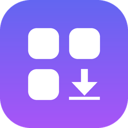
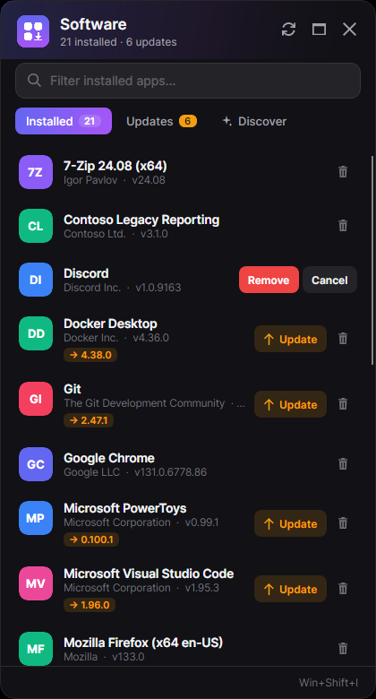
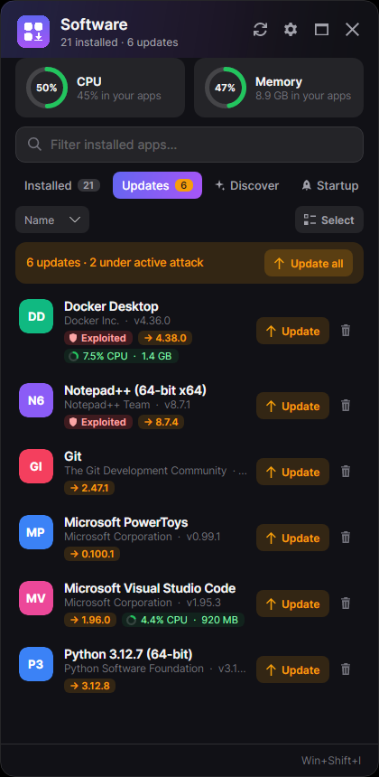
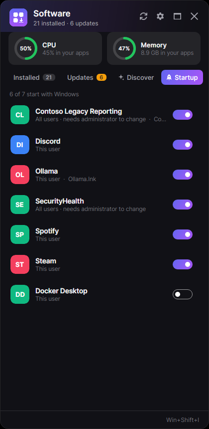
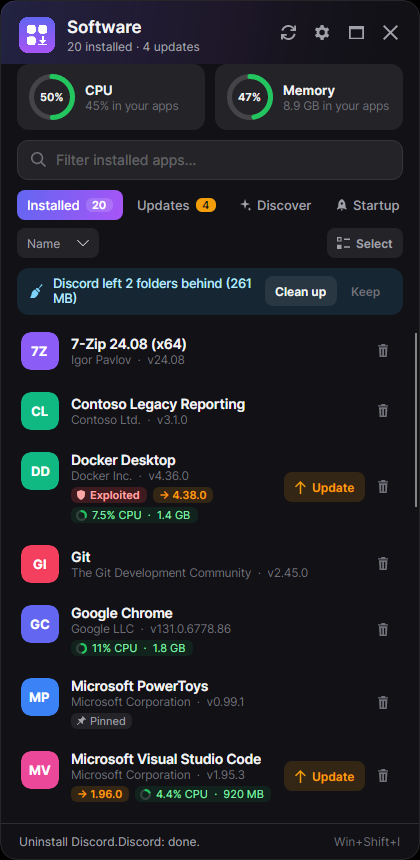
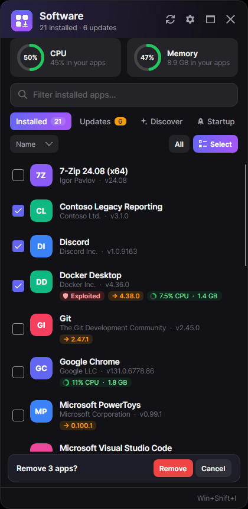
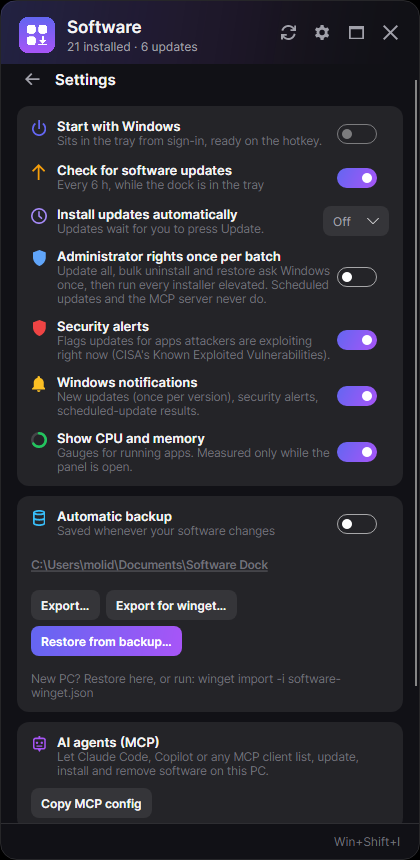
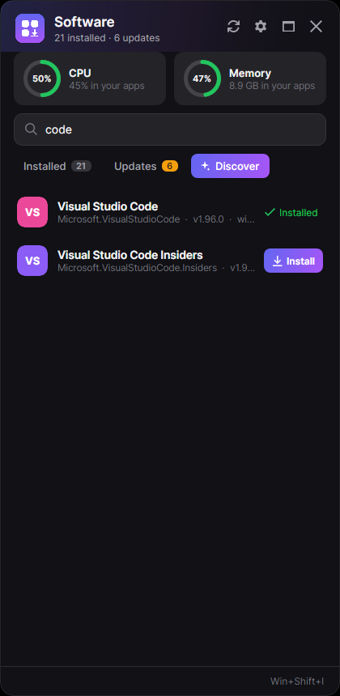
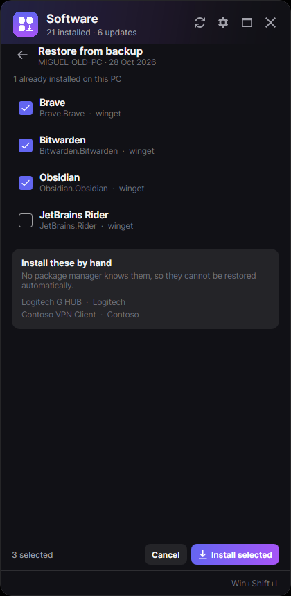

<p align="center">
  
</p>

<h1 align="center">Software Dock</h1>

<p align="center">
  The software on your Windows PC, one click from the taskbar — and one tool call from your AI agent.
</p>

<p align="center">
  <a href="https://github.com/molidestroyer/windows-software-mcp/actions/workflows/ci.yml"></a>
  
  
  
</p>

---

Windows makes managing installed software tedious: *Settings › Installed apps* cannot update
anything or remove more than one app at a time, WinGet is a console, and the Store only knows its
own apps. **Software Dock** lives in the notification area and opens a panel on the right edge of
the screen with everything that is installed, what can be updated, what is running and how much
it uses, and a search box over the WinGet and Microsoft Store catalogs.

The same capabilities are exposed as an **MCP server**, so Claude Code, Copilot or any MCP client
can answer *"what do I have installed?"*, *"what is eating my memory?"*, *"update everything"* or
*"install VLC"*.

| Installed + gauges | Updates + security | Startup apps |
| --- | --- | --- |
|  |  |  |

| Leftovers, pinned, unused | Bulk uninstall | Settings |
| --- | --- | --- |
|  |  |  |

| Discover | Restore from backup |
| --- | --- |
|  |  |

*Rendered by the headless UI tests from the real window, in demo mode.*

## Features

- **Tray icon as a status light** — green: up to date · amber: updates waiting · blue: working ·
  red: the inventory could not be read. Click it, or press **Win+Shift+I**, to toggle the panel.
  Updates are checked in the background every 6 hours, so the tray turns amber on its own.
- **📌 Anchored / 🪟 floating** — anchored, the panel hugs the right edge at full height and hides
  when it loses focus; floating, it is a normal draggable window.
- **One inventory** — the `Uninstall` registry keys (what *Installed apps* shows) reconciled with
  WinGet (ids, available updates) and MSIX/Store apps, with real icons.
- **Bulk uninstall** — *Select*, tick several apps (or *All*), *Uninstall*: they are removed one
  after another. Something Windows itself does not offer.
- **Update one or all**, **install** from the catalog, **uninstall** anything — through WinGet when
  it knows the app, otherwise through the app's own uninstaller (silently for MSI and
  `QuietUninstallString`, never with guessed switches).
- **CPU and memory gauges** — for the machine and for every running app, measured only while the
  panel is open. Sort by *memory in use* to find the heavy ones.
- **Backups that survive a reinstall** — an automatic backup in `Documents\Software Dock` (OneDrive
  usually syncs it), updated whenever your software changes, in two formats: Software Dock's, and
  WinGet's, which restores a new PC with nothing but `winget import -i software-winget.json`.
  *Restore from backup* lists what is missing, ticks it all, installs it in one go, and names the
  apps you will need to fetch by hand.
- **Security alerts** — apps with an update pending that attackers are exploiting right now (CISA's
  Known Exploited Vulnerabilities catalog) get an *Exploited* badge and go first in Updates.
- **Startup apps** — everything Windows starts at sign-in, with Task Manager's own switch: disable
  without deleting, re-enable any time.
- **Leftovers** — after an uninstall, the folders it left behind (install folder, AppData,
  ProgramData) are offered for cleanup, to the Recycle Bin.
- **Unused apps** — *Not opened for 8 months* badges from Windows' own launch history, and a
  *Least used* sort to find what to remove.
- **Pin or skip** — right-click an app: *Skip version 2.47.1* or *Pin — never update*.
- **Administrator rights once per batch** (opt-in) — *Update all*, bulk uninstall and restore ask
  Windows once and run every installer elevated, instead of one UAC prompt per app. The elevation
  ends with the batch; scheduled updates and the MCP server never use it.
- **Updates on a schedule** — every night or every Sunday night; a run missed while the PC was off
  happens when it wakes.
- **Windows notifications** — new updates (once per version), security alerts first, scheduled-run
  results, a new dock version.
- **Start with Windows**, single instance, per-monitor DPI, settings per user.
- **Updates itself** from GitHub releases (Velopack): it downloads in the background and offers
  *Restart to update*.
- **MCP server** with discovery instructions, tool annotations and a `--read-only` mode.

## Install

Download **`SoftwareDock-win-Setup.exe`** from the [latest release](https://github.com/molidestroyer/windows-software-mcp/releases/latest)
and run it. It installs per user (no admin) to `%LOCALAPPDATA%\SoftwareDock`, adds a Start-menu
entry and starts in the tray. A portable zip is attached to every release too.

The installer is not code-signed yet, so SmartScreen may ask you to confirm the first time.

Or with WinGet, once the package has been accepted into the community repository:

```bash
winget install MiguelMolina.SoftwareDock
```

## Build from source

Requirements: [.NET 10 SDK](https://dotnet.microsoft.com/download/dotnet/10.0) and WinGet
(*App Installer*, preinstalled on current Windows).

```bash
dotnet run --project src/SoftwareDock.App
```

Without touching your machine (in-memory demo PC):

```bash
dotnet run --project src/SoftwareDock.App -- --demo
```

Test:

```bash
dotnet test SoftwareDock.slnx
```

`appsettings.json` next to the executable configures the hotkey and panel width; everything you
change in ⚙️ is stored in `%LOCALAPPDATA%\SoftwareDock\settings.json`.

## Releasing

Bump `<Version>` in `Directory.Build.props` and push to `main`. When no release exists for that
version, CI tests, publishes self-contained, packs with Velopack, tags `vX.Y.Z` and creates the
release that installed docks update from. Pushing a `v*` tag by hand does the same.
Then it attaches the MCP bundle, publishes to the MCP Registry and opens the WinGet PR — see
[Distribution](docs/distribution.md).

## Connect an AI agent (MCP)

**Claude Desktop:** download **`SoftwareDock-mcp-win-x64.mcpb`** from the
[latest release](https://github.com/molidestroyer/windows-software-mcp/releases/latest) and open it:
it installs the server, no dock needed. The server is also listed in the
[MCP Registry](https://registry.modelcontextprotocol.io) as `io.github.molidestroyer/software-dock`.

**Any other client:** from the tray menu choose **Copy MCP config**, or print it:

```bash
SoftwareDock.Mcp.exe --print-config
```

and paste it into your client's `.mcp.json`:

```json
{
  "mcpServers": {
    "software-dock": {
      "type": "stdio",
      "command": "C:\\Tools\\SoftwareDock\\SoftwareDock.Mcp.exe",
      "args": []
    }
  }
}
```

On connect, the server sends **instructions** that tell the agent what it is for, which identifier
each tool takes and where it comes from, and to confirm changes with the user first.

| Tool | Kind | What it does |
| --- | --- | --- |
| `list_installed_software` | read-only | Installed apps with version, available update and `key`; filter, only-updates, refresh |
| `get_software_details` | read-only | Location, date, size and how it would be uninstalled |
| `search_software_catalog` | read-only | WinGet + Microsoft Store search, returns `packageId` |
| `install_software` | changes the PC | Silent install of a `packageId` |
| `upgrade_software` | changes the PC | Upgrade an installed app by `key` |
| `uninstall_software` | destructive | Remove an installed app by `key` |
| `list_running_software` | read-only | Running apps with CPU % and memory, heaviest first |
| `export_software_backup` | read-only | Backup JSON in Software Dock or `winget import` format |
| `get_security_advisories` | read-only | Apps with pending updates that are actively exploited (CISA KEV) |
| `list_unused_software` | read-only | Apps not opened for N days, largest first |
| `list_startup_apps` | read-only | What starts with Windows, enabled or not, and which app it belongs to |
| `set_startup_app_enabled` | changes the PC | Enable/disable a startup app the way Task Manager does |

Add `"args": ["--read-only"]` to expose only the read-only tools.

## Architecture

```
src/
  SoftwareDock.Domain          pure model and rules — no I/O
  SoftwareDock.Application     use cases over ports (inventory, operations)
  SoftwareDock.Infrastructure  Windows adapters: registry, WinGet CLI, uninstallers
  SoftwareDock.Mcp             MCP server (stdio)
  SoftwareDock.App             Avalonia tray dock
tests/                         one test project per layer, incl. headless UI and MCP end to end
docs/adr/                      architecture decisions
```

Decisions worth reading before changing things:

1. [Ports and adapters around a pure domain](docs/adr/0001-ports-and-adapters.md)
2. [WinGet through its CLI first, behind a port](docs/adr/0002-winget-cli-first.md)
3. [A tray app in Avalonia, not a PowerToys module](docs/adr/0003-tray-app-not-powertoys-module.md)
4. [MCP: discovery through instructions, safety through the domain](docs/adr/0004-mcp-discovery-and-safety.md)
5. [Releases and self-update with Velopack](docs/adr/0005-self-update-with-velopack.md)
6. [PC hygiene: startup, security, leftovers, unused apps, schedules, notifications](docs/adr/0006-pc-hygiene-features.md)

## How it compares

| | Software Dock | [UniGetUI](https://github.com/marticliment/UniGetUI) | WinGet's [built-in MCP server](https://learn.microsoft.com/en-us/windows/package-manager/winget/mcp-server-overview) | PowerToys [Command Palette](https://learn.microsoft.com/en-us/windows/powertoys/command-palette/overview) |
| --- | --- | --- | --- | --- |
| Lives in the tray | ✅ panel docked to the screen edge | ✅ window + tray menu | — | launcher (Win+Alt+Space) |
| Installed apps WinGet does not know | ✅ registry reconciled | partial | — | — |
| Update / uninstall | ✅ | ✅ (+ Scoop, Chocolatey, npm…) | — (find, install) | install |
| Bulk uninstall | ✅ | ✅ | — | — |
| CPU / memory per app | ✅ | — | — | — |
| Backup / restore | ✅ (+ `winget import` format) | ✅ | — | — |
| Exploited-vulnerability alerts | ✅ | — | — | — |
| Startup apps / leftovers / unused apps | ✅ | — | — | — |
| MCP server for agents | ✅ inventory + install/upgrade/uninstall | — | ✅ find + install | — |

UniGetUI is the most complete GUI if you want many package managers. Software Dock is deliberately
smaller: Windows software only, one glance from the taskbar, and an agent-friendly API.

## License

[AGPL-3.0](LICENSE) © Miguel Molina
